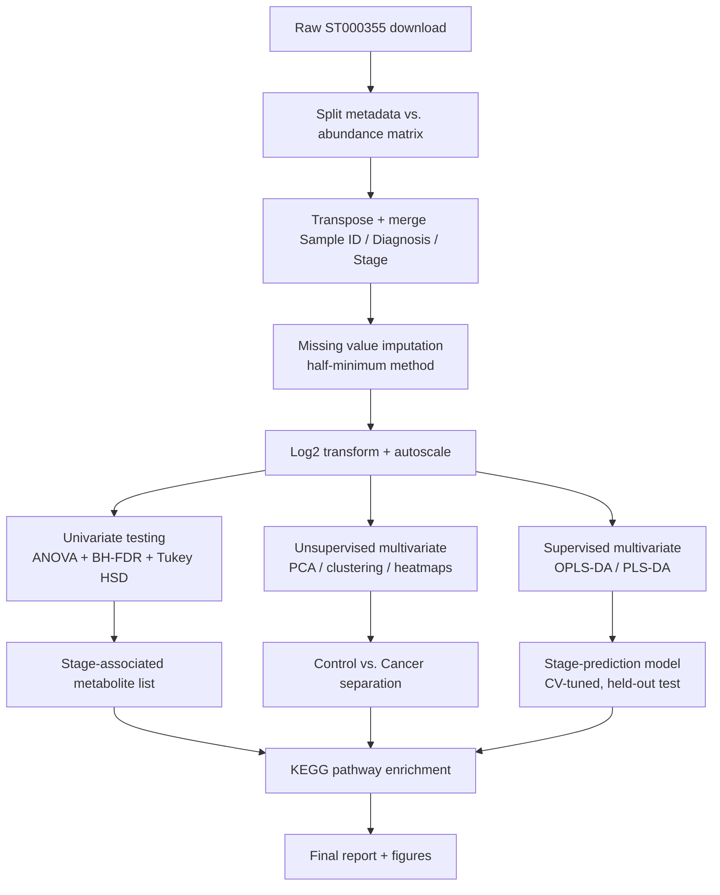

# DECODE-2026-Team-Metabolomics

# Metabolomic Profiling of Human Breast Cancer Plasma Using LC-MS to Identify Disease-Associated Metabolic Signatures

**Purpose:** Analyze the public Metabolomics Workbench **ST000355** plasma dataset (LC-MS) to identify metabolites and multivariate patterns that distinguish breast cancer patients (Stages I–IV) from healthy controls.

**Team:** Ujjalkumar, Bidisha, Akanksha

**Intended Users:** Bioinformaticians, Researchers, Clinicians

## Core Values

| Value | Description |
|---|---|
| **Reproducibility** | Every analysis and figure should be regeneratable from the raw ST000355 files and the scripts here. |
| **Transparency** | Imputation, transformation, and multiple-testing decisions are documented. |
| **Statistical rigor** | Multiple testing correction (Benjamini–Hochberg), post-hoc pairwise testing (Tukey HSD), and covariate awareness (age) are implemented. |
| **Open science** | Built entirely on a public, citable dataset. |

## Research Problem

Breast cancer is a leading cause of cancer-related mortality in women. Imaging and histopathology remain the primary diagnostic tools, but metabolic alterations occur early in tumor development and may offer complementary biomarkers for diagnosis, staging, and prognosis. This project uses the **ST000355** plasma metabolomics study to ask whether metabolite abundance patterns track disease status and disease stage.

## Hypothesis

Plasma metabolite profiles differ systematically between breast cancer patients and healthy controls, and a subset of metabolites (amino acids, acylcarnitines, organic acids, steroid/lipid intermediates) show further differences across cancer Stages I–IV that could support stage-informed classification.

## Scope

- Reversed-phase LC-MS dataset from **ST000355**: **211 plasma samples** (76 controls; Stage 1 *n*=19, Stage 2 *n*=49, Stage 3 *n*=47, Stage 4 *n*=20) × **99 named metabolites**.
- Univariate testing (one-way ANOVA + BH-FDR, Tukey HSD post-hoc)
- Unsupervised multivariate analysis (PCA, hierarchical clustering, heatmaps)
- Supervised multivariate analysis (OPLS-DA)
- Stage-prediction model

## Non-Goals
- No new wet-lab sample collection or mass-spec re-acquisition — this is a secondary/reanalysis project.
- No mechanistic or causal claims about *why* a metabolite changes (pathway interpretation is discussed qualitatively only).
- No claim of clinical diagnostic validity. Outputs are exploratory/hypothesis-generating, **not** a validated clinical test.
- Longitudinal disease progression is not directly assessed.

## Success Criteria

- Metadata (Sample ID, Diagnosis, Stage) cleanly merged with the abundance matrix for all 211 samples.
- Missing-value profile documented and imputed (half-minimum method) for all 10 affected metabolites.
- Log2 transformation demonstrably reduces per-compound skewness (raw vs. log2 skewness comparison).
- PCA and OPLS-DA score plots produced and visually assessed for Control vs. Cancer separation.
- ≥1 statistically robust list of stage-associated metabolites (BH-adjusted *p* < 0.05) with Tukey-identified contrasts.
- A stage-prediction model trained and evaluated with a held-out/cross-validated performance metric.
- All figures (PCA score/loading plots, diverging ratio plots, heatmaps, dendrograms) regenerate from the checked-in scripts without manual editing.

## Workflow / Analysis Plan


### Pipeline Flow Chart



### Setup / Requirements

```bash
# R version
R version 4.x

# RStudio version
RStudio 2026.07.1+147
```

```r
# Required R packages
install.packages(c(
  "tidyverse",
  "dplyr",
  "tidyr",
  "ggplot2",
  "pheatmap",
  "ggrepel",
  "tibble",
  "purrr"
))
```

### Data Download Paths

| Item | Location |
|---|---|
| Study | [Metabolomics Workbench – ST000355](https://www.metabolomicsworkbench.org/) |
| Analysis ID | AN000581 |
| Data | `data/ST000355_AN000581.txt` |

## Methods

### Analysis Approach

All data preprocessing, statistical analysis, and visualization were performed using **RStudio (version 2026.07.1+147)** and **R (version 4.x)**.

LC-MS abundances (99 compounds, 211 samples: 76 Control, 135 Cancer Stages 1–4) were log2-transformed, then each compound was tested for association with Stage via ANOVA (BH-corrected) with Tukey post-hoc and Welch cross-checks. Multivariate methods (clustering, PCA, sample correlation) and KEGG pathway enrichment followed.

For prediction, we used **leakage-free PLS-DA** (train-only feature selection, CV-tuned, held-out test evaluation):

- **1** Control-vs-Cancer model → **AUC 0.95**
- **4** stage-specific Stage-vs-Control models → **AUC 0.87–1.00**

Finally, per-compound linear regression tested receptor status, Age, and BMI as covariates.

### Dataset Description and Access

| Field | Value |
|---|---|
| **Repository** | [Metabolomics Workbench](https://www.metabolomicsworkbench.org/) |
| **Study ID** | ST000355 |
| **Analysis ID** | AN000581 |
| **Platform** | Untargeted Liquid Chromatography–Mass Spectrometry (LC-MS) |
| **Biological samples** | Human plasma |
| **Total samples** | 211 |
| **Breast cancer** | 135 |
| **Healthy controls** | 76 |
| **Metabolites analyzed** | 99 quantified metabolites after preprocessing |

The dataset is **publicly available** through the Metabolomics Workbench database.

**Software**
- RStudio (version 2026.07.1+147)
- R (version 4.x)

**R Packages**
- `tidyverse`
- `dplyr`
- `tidyr`
- `ggplot2`
- `pheatmap`
- `ggrepel`
- `tibble`
- `purrr`

### Data Preprocessing

1. The first row of the downloaded dataset (containing sample metadata) was separated from the metabolite abundance data.
2. Metabolite values were converted to numeric format, and the dataset was transposed so that rows represented samples and columns represented metabolites.
3. Metadata (sample ID, diagnosis, and stage) were merged with the metabolite abundance matrix.
4. **Missing values:** Assessed for each metabolite — only **10 metabolites** contained missing values. Missing observations were replaced using the **half-minimum imputation method**, where each missing value was substituted with half of the smallest positive value observed for that metabolite.
5. **Transformation:** To stabilize variance and reduce skewness, metabolite abundances were transformed using **log₂(x + 1)**.
6. **Scaling:** The transformed data were autoscaled (z-score normalization) so that each metabolite had a mean of zero and a standard deviation of one.

### Data and Statistical Analysis

- **PCA** — performed to explore clustering patterns between breast cancer and control samples.
- **Differential abundance** — evaluated using Student's t-test.
- **Multiple testing correction** — p-values adjusted using Benjamini–Hochberg FDR; metabolites with **FDR < 0.05** were considered statistically significant.
- **Visualization** of significant metabolites via:
  - Principal Component Analysis (PCA)
  - Volcano plot
  - Heatmap

### Biological Interpretation

The biological functions of significant metabolites were interpreted through a literature review of published breast cancer metabolomics studies. Metabolites were grouped into major metabolic pathways, including:

- Amino acid metabolism
- Lipid metabolism / fatty acid β-oxidation
- Nucleotide metabolism
- Oxidative stress / redox metabolism

## Limitations

- **Cross-sectional design:** Cannot support strict claims of metabolic "progression" over time — only stage-group differences at a single time point per patient.
- **Weak stage-vs-stage differences:** Differences among cancer cases across stages are weak and inconsistent (0–5 of 42 compounds per pairwise contrast). The robust result in this dataset is **Cancer-vs-Control**, not stage-wise differences.

